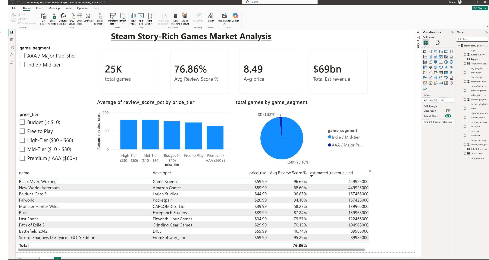

#  Steam Story-Rich Games Market Analysis

An end-to-end Data Analytics project analyzing the market performance, pricing strategies, and user satisfaction of **Story-Rich & Single-Player Video Games** on Steam.

---

##  Dashboard Preview


---

##  Project Objectives & Business Questions
1. **Price Sensitivity:** Does a higher game price reflect higher user satisfaction (% Positive Reviews)?
2. **Indie vs. AAA Market Dynamics:** How do independent developers compare against major publishers in volume and revenue?
3. **Engagement Analysis:** Which price tiers deliver the highest average player engagement (playtime)?

---

##  Tech Stack & Workflow
* **Data Extraction:** Python (`requests`, SteamSpy Web API)
* **Data Cleaning & Wrangling:** Python (`pandas`, `numpy`)
* **Data Visualization:** Power BI Desktop
* **Data Modeling:** DAX (Data Analysis Expressions)

---

##  Key Business Insights

* **The Happiness Price Point ($10 – $60):** Games priced in the **Mid-Tier ($10–$30)** and **High-Tier ($30–$60)** achieved the highest average user satisfaction (**~80%+ Positive Rating**).
* **AAA Expectations Gap:** Premium $60+ AAA titles experienced a lower average review score (**63.6%**), highlighting higher player expectations for full-priced titles.
* **Indie Dominance in Volume:** Independent / Mid-tier titles represent over **98%** of total story-rich catalog listings on Steam, while AAA titles generate higher revenue concentration per title.

---

##  Repository Structure
```text
├── steam_story_games_scraper.py   # Python script for API data fetching
├── steam_data_cleaning.ipynb      # Data wrangling & EDA notebook
├── steam_story_games_cleaned.csv  # Cleaned dataset ready for BI
├── Steam_Story_Games_Dashboard.pbix # Power BI Dashboard file
└── dashboard_preview.png          # Dashboard screenshot
